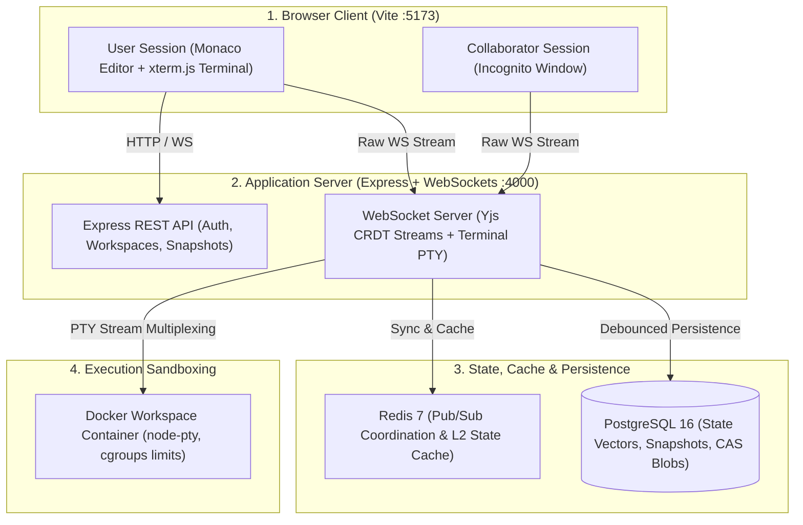

<div align="center">

# NexusIDE

### Collaborative In-Browser IDE & Development Environment

**Real-Time CRDT Collaboration** • **Docker Sandboxes** • **Interactive Terminals** • **Language Server Protocol** • **Local-First Architecture**

[View Repository](https://github.com/AmanKashyapp07/NexusIDE) · [Report Issue](https://github.com/AmanKashyapp07/NexusIDE/issues)

---

</div>

**NexusIDE** is a collaborative, web-based software development environment running locally. It combines the editing experience of **Monaco Editor** (the engine powering Visual Studio Code), the conflict-free multiplayer collaboration of **Yjs CRDTs**, and private, interactive **Docker-backed Linux terminals** into a unified browser interface.

Multiple developers can write code together in real time, observe collaborator cursor movements and selections live, execute shell programs in private interactive terminals, and inspect Git-style version snapshots without environment friction.

---

## Why I Built This

Setting up local development environments often introduces friction. When teams or peers collaborate on code, they lose time installing mismatched toolchains, diagnosing OS differences, and resolving manual merge conflicts.

I built NexusIDE to make collaborative software development clean, immediate, and technically robust:
- **Zero-Friction Collaboration:** Open a workspace URL locally in two separate browser sessions and start pair-programming immediately.
- **Conflict-Free State:** Edit documents concurrently with deterministic convergence powered by CRDTs.
- **Resource-Efficient Sandboxing:** Share a single workspace filesystem while providing each collaborator an independent pseudo-terminal (PTY) session.
- **Container Isolation:** Execute untrusted user code inside isolated Docker containers with memory, CPU, and process limits.

---

## Table of Contents

- [Core Capabilities](#core-capabilities)
- [System Architecture](#system-architecture)
- [Deep-Dive Engineering Highlights](#deep-dive-engineering-highlights-for-technical-interviewers)
- [Tech Stack](#tech-stack)
- [Getting Started (Local Development)](#getting-started-local-development)
- [Testing & Quality Assurance](#testing--quality-assurance)
- [Future Roadmap](#future-roadmap)
- [License](#license)

---

## Core Capabilities

### 1. Multiplayer Real-Time Collaborative Editing
Type concurrently in the same file across multiple sessions. Edits merge deterministically using Yjs CRDTs without central locking or overwriting, complemented by live collaborator presence tags and color-coded cursors.

### 2. Isolated Interactive Terminals
Each collaborator is allocated an independent interactive Linux terminal session (`bash` via `node-pty`) inside the workspace container. Teammates can run tests, compile code, or inspect outputs without interfering with each other's terminal state.

### 3. Monaco Editor Integration
Powered by Monaco Editor, providing desktop-grade syntax highlighting, multi-cursor editing, bracket matching, code folding, and configurable keybindings.

### 4. Language Server Protocol (LSP)
Intelligent code completion, hover documentation, and real-time syntax diagnostic squiggles delivered over WebSockets for TypeScript, JavaScript, and Python.

### 5. Interactive Keystroke Timelapse
A deterministic timeline replay engine allowing developers to scrub backward and forward through document history keystroke-by-keystroke to inspect code evolution.

### 6. Visual 3-Way Merge Conflict Resolver
Visual diff and conflict resolution interface allowing side-by-side comparison of conflicting versions with one-click resolution.

### 7. Role-Based Access Control (RBAC)
Workspace permissions enforced across REST, WebSocket, and terminal layers:
- **Viewer:** Read-only document inspection and real-time edit observation.
- **Editor:** File authoring, collaborative editing, and terminal execution.
- **Owner:** Workspace configuration, file deletion, and collaborator invitation management.

---

## System Architecture

NexusIDE coordinates browser clients, local Node.js servers, databases, and Docker container sandboxes in a 4-tier pipeline:



1. **Client Layer:** The browser renders Monaco Editor for code editing and xterm.js for the terminal. Changes are packaged into compact binary CRDT updates.
2. **Server Gateway:** An Express and `ws` server validates JWT authentication and workspace roles before routing updates to active document instances.
3. **State & Persistence:** Redis coordinates live awareness and serves as an L2 cache. PostgreSQL stores binary Yjs state vectors, workspace metadata, and content-addressed snapshot trees.
4. **Sandboxed Execution:** Terminal sessions attach to a Docker container via `node-pty`, isolating execution with cgroups resource boundaries.

---

## Deep-Dive Engineering Highlights (For Technical Interviewers)

This section outlines key distributed systems decisions, algorithmic implementations, and performance optimizations implemented in NexusIDE:

<details>
<summary><b>1. Conflict-Free Collaboration with Yjs CRDTs</b></summary>
<br/>

* **Decentralized Convergence:** Uses Conflict-Free Replicated Data Types (Yjs YATA model). Edits are commutative and idempotent, converging deterministically across all sessions regardless of packet arrival order.
* **Separation of Awareness and Content:** Ephemeral state (cursor coordinates, active selections) is managed in a separate awareness channel, preventing cursor broadcasts from bloating persistent document history.
* **Buffer Allocation Safety:** Node.js sliced buffers share memory with their underlying `ArrayBuffer`. Binary CRDT decoding strictly specifies offset boundaries (`new Uint8Array(buf.buffer, buf.byteOffset, buf.byteLength)`) to eliminate memory corruption bugs.
</details>

<details>
<summary><b>2. Velocity-Adaptive Database Persistence Debouncer</b></summary>
<br/>

* **The Problem:** Writing raw keystroke updates synchronously to PostgreSQL causes catastrophic write amplification under active typing bursts.
* **The Solution (`AdaptivePersistenceDebouncer`):** Dynamically scales persistence intervals based on typing velocity calculated in a sliding 1-second window:
  * **300ms** during typing pauses.
  * **800ms** standard typing pace.
  * Scales up to **2,500ms** during rapid bursts (>5 edits/sec).
  * Enforces a **5,000ms hard ceiling** forced flush to guarantee bounded recovery windows during sustained typing.
* **Result:** Decreases database write IOPS by ~75% while maintaining strong data durability guarantees.
</details>

<details>
<summary><b>3. Redis Synchronization & Distributed Mutex</b></summary>
<br/>

* **Cross-Session Coordination:** Redis Pub/Sub channels broadcast document updates and collaborator presence, using origin tagging to prevent reflective echo loops.
* **Distributed Mutex (`distributedLock.service.ts`):** Before flushing debounced states to PostgreSQL, the node acquires a Redis mutex (`SET lockKey POD_ID PX ttl NX`) with an atomic Lua release script, backed by an in-memory fallback when running without Redis.
* **Optimistic Version Checks:** Database persistence statements execute conditional updates (`WHERE version = :v`) to prevent race conditions during concurrent snapshot writes.
</details>

<details>
<summary><b>4. Shared Workspace Containers & PTY Stream Multiplexing</b></summary>
<br/>

* **Resource Consolidation:** Collaborators in the same workspace share a single Docker container environment mounted to the workspace filesystem.
* **PTY Process Isolation:** Each user's WebSocket connection spawns an isolated `container.exec()` pseudo-terminal (`/dev/pts/X`) with custom environment variables (`USER`, `GIT_AUTHOR_NAME`), providing independent shell sessions on the shared workspace.
* **Graceful Degradation:** If Docker Desktop is unavailable, the backend continues to serve editor, CRDT synchronization, and persistence paths without crashing.
</details>

<details>
<summary><b>5. Bit-Packed Binary Cursor Codec (96.8% Bandwidth Reduction)</b></summary>
<br/>

* **Packet Overhead Reduction:** Standard JSON cursor payloads (`{"user":"...","line":12,"column":4}`) consume ~250 bytes per movement event.
* **8-Byte Binary Framing:** [`cursorCodec.service.ts`](backend/src/services/cursorCodec.service.ts) packs coordinates into a compact 8-byte binary layout:
  * `[uint16 userHash, uint16 line, uint16 col, uint16 selectionLength]`
* **Bandwidth Efficiency:** Achieves a **96.8% reduction** in network awareness bandwidth, keeping collaborator cursor rendering smooth under high-frequency movement.
</details>

<details>
<summary><b>6. Git-Style Merkle DAG Content-Addressable Storage (CAS)</b></summary>
<br/>

* **Content-Addressed Storage:** Files, trees, and workspace snapshots are stored in PostgreSQL using cryptographic **SHA-256** content hashes (`git_blobs`, `git_trees`, `git_commits`).
* **Deduplication:** Unmodified files across snapshots reference existing blob hashes with `ON CONFLICT DO NOTHING`, drastically reducing snapshot storage footprint.
* **Worker Thread Hashing:** Snapshot DAG computation is offloaded to a Node.js Worker Thread (`workerPool.service.ts`) to prevent SHA-256 hashing from blocking the event loop.
* **Safe Garbage Collection:** [`casGarbageCollector.service.ts`](backend/src/services/casGarbageCollector.service.ts) identifies and cleans orphaned blobs unreferenced by any snapshot commit.
</details>

---

## Tech Stack

| Layer | Technologies |
| :--- | :--- |
| **Frontend** | React 19, TypeScript, Tailwind CSS, Monaco Editor, xterm.js, Vite |
| **Backend** | Node.js, Express, WebSockets (`ws`), Socket.io |
| **Real-Time Collaboration** | Yjs (CRDTs), Redis Pub/Sub, Custom Binary Cursor Codec |
| **Storage & Caching** | PostgreSQL 16 (Binary State Vectors, Covering B-Tree Indexes), Redis 7 |
| **Compute & Sandboxing** | Docker Engine API (`dockerode`), Linux PTYs (`/dev/pts`), cgroups |
| **Testing** | Vitest, fast-check (property-based fuzzing), Playwright (E2E) |

---

## Getting Started (Local Development)

### Prerequisites

- **Node.js**: v18 or higher (`node -v`)
- **npm**: v9 or higher (`npm -v`)
- **PostgreSQL**: v14 or higher (running on port `5432`)
- **Docker Desktop**: (Optional but recommended for terminal sandboxing)
- **Redis**: (Optional; falls back to in-memory caching if offline)

### One-Command Startup

The repository includes a self-contained local orchestrator ([`dev.sh`](dev.sh)) that runs preflight checks, frees port collisions, verifies database schemas, and boots both servers:

```bash
# 1. Clone repository
git clone https://github.com/AmanKashyapp07/NexusIDE.git
cd NexusIDE

# 2. Run the startup script
bash dev.sh

# Or start quickly if dependencies are already installed:
bash dev.sh --skip-deps
```

### Accessing the Local Demo

Once started, the application is ready immediately:

- **Primary Session**: [http://localhost:5173/ide](http://localhost:5173/ide)
- **Collaborator Session**: Open an **Incognito / Private Window** to [http://localhost:5173/ide](http://localhost:5173/ide)
- **1-Click Credentials**: Username: `demo` · Password: `test`
- **Backend API**: [http://localhost:4000/api/auth/me](http://localhost:4000/api/auth/me)

To stop all servers and free ports, press `Ctrl+C` in the terminal.

---

## Testing & Quality Assurance

NexusIDE includes comprehensive test coverage across algorithms, synchronization contracts, and UI components:

```bash
# 1. TypeScript typecheck across backend and frontend
npm run typecheck

# 2. Run backend service tests (Binary cursor codec, adaptive debouncer, CAS Merkle DAG)
npm run test:backend

# 3. Run frontend component & hook tests (Monaco lifecycle, blame annotations, Yjs batching)
npm run test:frontend

# 4. Run all unit and service tests
npm run test:all
```

---

## Future Roadmap

1. **MicroVM Sandboxing (Firecracker / gVisor):** Evaluating hardware-isolated microVMs for enhanced multi-tenant security boundaries.
2. **Client-Side WASM Formatters:** Running language linters and code formatters directly inside browser WebAssembly workers.
3. **WebRTC Voice Channels:** Integrated peer-to-peer audio channels for direct pair-programming communication.
4. **Inline Autocomplete Assistance:** Context-aware inline ghost text suggestions powered by local code completion models.

---

## License

This project is open source and available under the [MIT License](LICENSE).

<div align="center">

Built and maintained by **Aman Kashyap** · [GitHub Profile](https://github.com/AmanKashyapp07)

</div>
